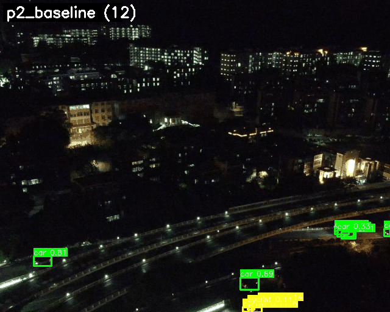
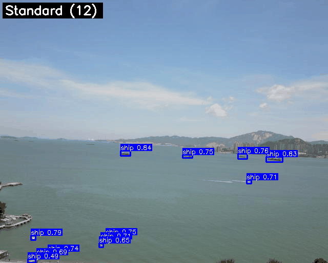

# Small Objects, Higher Resolution

### YOLOv8n + P2 heads + sliced inference on RGBT-Tiny

An experimental computer-vision pipeline for finding tiny objects in aerial imagery: establish an RGB baseline, add a higher-resolution detection head, then measure whether SAHI's extra detections justify its inference cost.

**Python / PyTorch / Ultralytics / SAHI / OpenCV**

[Results](#results) | [Run the experiments](docs/REPRODUCING.md) | [Evaluation notes](docs/EVALUATION.md) | [Course report](docs/report.pdf)



*Recorded model predictions, not a live application. Animation playback speed is not an inference benchmark.*

## The experiment

| Stage | Change | Question |
| --- | --- | --- |
| Baseline | Standard YOLOv8n, RGB inputs | How does a small detector perform on tiny targets? |
| P2 | Add a stride-4 detection head alongside P3/P4/P5 | Does finer feature resolution improve tiny-object recall and AP? |
| P2 + SAHI | Overlapping crops, full-image prediction, merged detections | How much accuracy can inference-time slicing recover, and at what cost? |

The repository includes data preparation, model configuration, training, size-aware evaluation, staged SAHI searches, latency benchmarking, and visualization scripts. Exploratory normalized Wasserstein distance (NWD) loss variants are retained in `src/utils/` and the corresponding training scripts; they are not the headline result.

**Scope:** RGB-only detection experiments on the visible-thermal RGBT-Tiny dataset. This is not a deployed edge-AI system and does not claim RGB/thermal fusion in this repository.

## Results

Historical validation results from the saved experiment artifacts, not a new training run. Values below are percentages; differences are percentage points.

### Architecture comparison

| Metric | YOLOv8n | YOLOv8n + P2 | Difference |
| --- | ---: | ---: | ---: |
| mAP@0.5 | 91.99 | 92.89 | +0.90 |
| mAP@0.5:0.95 | 62.60 | 63.11 | +0.51 |
| Tiny AP@0.5, custom evaluator | 83.35 | 87.47 | +4.12 |

Sources: [baseline JSON](docs/results/naive-validation.json), [P2 JSON](docs/results/p2-validation.json). The size evaluator uses a prediction confidence floor of 0.001. Overall metrics come from Ultralytics validation; custom size metrics are not official COCO size AP.

### Sliced inference comparison

| Custom metric | P2 standard | P2 + SAHI | Difference |
| --- | ---: | ---: | ---: |
| Tiny AP@0.5 | 82.36 | 85.13 | +2.77 |
| Small AP@0.5 | 87.89 | 91.36 | +3.47 |
| GT-count-weighted size AP@0.5 | 83.40 | 86.30 | +2.90 |

Both use a confidence floor of **0.25**. Selected SAHI configuration: 512-pixel slices, 20% overlap, GreedyNMM, IoU matching at 0.7, plus full-image prediction. [Raw comparison](docs/results/sahi-validation.json).



*Selected qualitative example. More predicted boxes do not, on their own, demonstrate higher accuracy.*

### Inference cost

| Method | Mean per-image FPS | Mean latency |
| --- | ---: | ---: |
| YOLOv8n | 53.1 | 19.1 ms |
| P2 | 48.1 | 20.9 ms |
| P2 + SAHI | 9.5 | 106.1 ms |

[Historical benchmark](docs/results/fps-test.txt): 50 test images, 10 warmup images, confidence 0.3. This benchmark uses SAHI IoS/0.5, **not** the IoU/0.7 accuracy configuration above. Hardware and library versions were not recorded in that artifact, so these are illustrative local measurements, not portable performance promises. P2 is not cost-free; slicing has a much larger cost in this run.

## What to take away

- P2 improves the custom tiny-object metric in this experiment, with extra computation.
- SAHI's confidence floor and merging settings matter; slicing is not an automatic improvement.
- Accuracy and latency must be measured together with identical settings before making deployment decisions.
- Validation was sampled at frame level from the official training list. Nearby frames can cross the train/validation boundary. These results do not establish generalization to unseen scenes.

Read the [evaluation caveats](docs/EVALUATION.md) before comparing these numbers with other benchmarks. There are no multi-seed confidence intervals, and SAHI was selected on the same validation set used for the reported comparison.

## Start here

```bash
python -m venv .venv
# Activate .venv using your shell, then install a suitable PyTorch build.
python -m pip install -r requirements.txt
python -m unittest discover -s tests -v
```

Dataset and trained weights are intentionally **not bundled**. Follow the [reproduction guide](docs/REPRODUCING.md) for dataset access, preparation, training and evaluation commands. Some historical evaluation/SAHI scripts require CUDA.

```text
configs/model/       P2 architecture; dataset YAML generated locally
scripts/             preparation, training, evaluation, searches, visualizations
src/utils/           exploratory NWD loss implementations
docs/assets/         selected GIFs and comparison plot
docs/results/        original metric and benchmark artifacts
docs/report.pdf     original joint coursework report
tests/              lightweight data/artifact checks, no GPU required
```

## Credits and provenance

Course project by **Ioannis Stasinopoulos and Bill Mentzinis**. This repository packages the small-object detection track. The original joint report also covers RGB/thermal fusion; that implementation is available in [Bill Mentzinis's companion repository](https://github.com/BillMentzinis/CV_Final_Project). Its results use a separate experimental setup and should not be mixed with the tables above.

- [RGBT-Tiny dataset and authors](https://github.com/XinyiYing/RGBT-Tiny)
- [Ultralytics YOLO](https://github.com/ultralytics/ultralytics)
- [SAHI](https://github.com/obss/sahi)
- [Normalized Gaussian Wasserstein Distance paper](https://arxiv.org/abs/2110.13389)

The existing repository [MIT license](LICENSE) does not relicense external dependencies, pretrained weights, the dataset, or dataset-derived imagery. Those remain subject to their respective owners' terms. See [third-party notices](docs/THIRD_PARTY.md).
