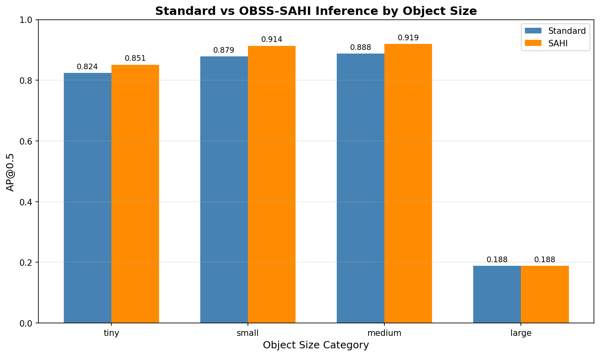

# Reading the results correctly

## Different evaluators answer different questions

Overall baseline mAP is produced by Ultralytics. The project-specific size evaluator filters predictions and ground truth by area, matches boxes at IoU 0.5 with class agreement, and computes pooled 101-point interpolated AP. Its weighted score is the ground-truth-count-weighted mean across size bins. Neither should be presented as official COCO AP-small or standard class-averaged mAP.

Size bins use area in pixels squared: tiny <256; small 256 to <1024; medium 1024 to <9216; large >=9216. A threshold of 256 does not mean both box dimensions must be below 16 pixels.

## What the evidence supports

The recorded P2 validation run improves the tiny-object score from 0.8335 to 0.8747. At confidence 0.25, the saved standard-versus-SAHI comparison improves that score from 0.8236 to 0.8513. These are separate comparisons: do not add their gains or rank the 0.001 and 0.25 tables as one common benchmark.

## Limits

- Validation is a random frame subset of the training list, not sequence-disjoint. Temporal similarity can inflate estimates of generalization.
- SAHI hyperparameters were selected using validation, and the highlighted results are also validation results. They are not an independent final test.
- Single recorded runs do not establish statistical significance. In particular, the 48 large-object ground truths do not justify dismissing the observed large-object regression as merely an artifact.
- Increased recall can come with more false positives. The qualitative GIF is a selected example, not a representative evaluation sample.
- The benchmark and accuracy run use different confidence and merge parameters. The benchmark artifact omits hardware/software versions and is not an edge-device benchmark.
- P2 adds computation. Its finest grid has twice the linear resolution and four times the cell count of P3, not four times the linear resolution.
- The original joint PDF is retained as a historical coursework artifact. Its fusion results are separate from this track; any broad claims about significance, generalization or performance should be read with the limitations here.

## Next defensible experiment

Freeze a sequence-disjoint split and package versions; verify pretrained initialization; train several seeds; use one consistent evaluator; tune only on validation; report held-out test AP, false positives, latency percentiles, hardware, memory and identical inference settings. This is future work, not a completed result.
